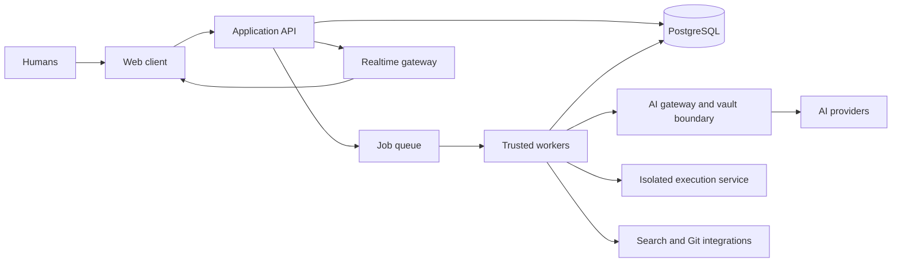
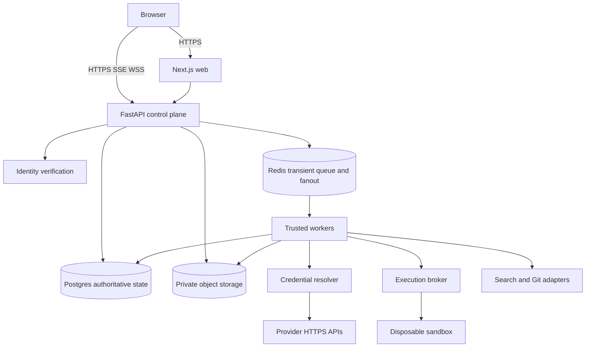
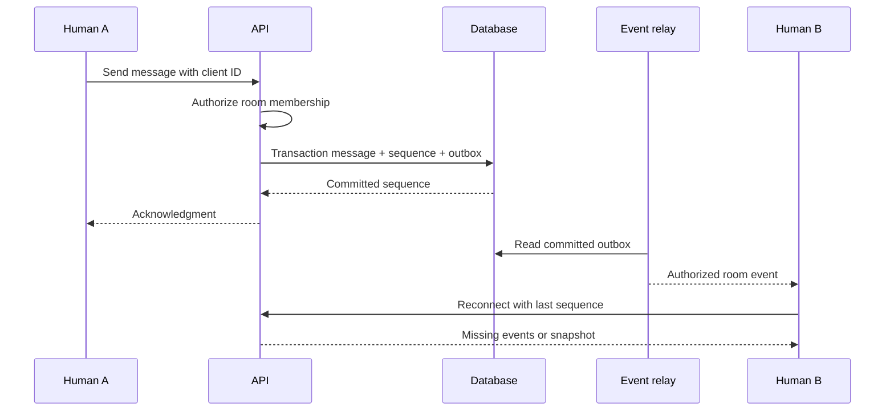
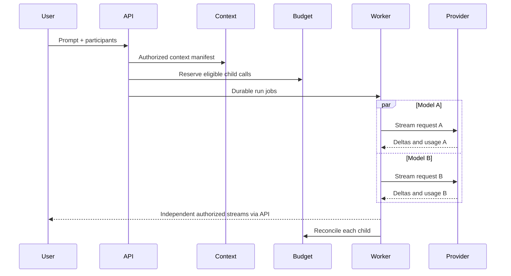
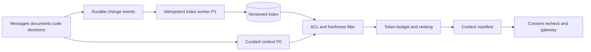
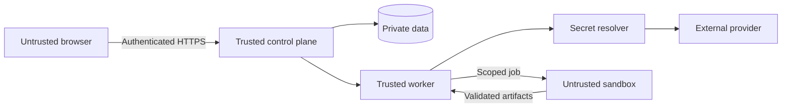

# AISwitch — System Architecture Document
Version 1.0 | 2026-11-25 | Proposed technical baseline

## 1. Scope and drivers
Derived from PRD/SRS v1.2, [HAC](19-human-ai-collaboration.md) and [CTX](20-shared-intelligence.md). P0 personal and small-team collaboration, BYOK, concurrent AI calls, durable shared context and cost control. Optimize for a small engineering team, low operating cost, security and portable source. No runtime implementation is asserted.

## 2. System context

External actors: human users, identity provider, model providers, Git hosting, search services and later deployment/media services. All external content is untrusted.

## 3. Architectural style and decisions
Modular monolith for control plane; separately deployed trusted background workers and isolated untrusted execution service. Seven logical engines are not seven required microservices. Proposed Next.js/React/TypeScript/Tailwind, FastAPI/Python, PostgreSQL/Supabase Auth and Storage, Redis for transient queue/fanout, pgvector P1, Monaco/xterm P1, SSE for model streams and WebSocket for room events. Expo/Tauri later. Supabase service credentials server-only; RLS defense in depth, not a substitute for API authorization. Confirm versions, hosting and licensing through ADRs. No external platform connection is required to approve this design.

## 4. Container topology

Web can be hosted on Vercel; API/workers on long-lived container hosting supporting streaming and WebSockets. Keep DB/Redis private and colocated where possible. Browser never receives provider credentials or direct sandbox control. Sandbox has no DB/vault access. Local bridge is a later opt-in authenticated component, not public access to localhost.

## 5. Logical module boundaries
| Engine | Owns | Interfaces | Phase |
|---|---|---|---|
| Collaboration | membership, rooms, messages, participants, activity | authorize, append, subscribe, invite | P0 |
| Shared intelligence | source revisions, curated facts, context manifests, later index | assemble, invalidate, retrieve | P0/P1 |
| Universal gateway | provider registry, credentials, models, adapter execution | discover, validate, stream, cancel | P0 |
| Resource optimization | budgets, reservations, usage, pricing | reserve, settle, release, report | P0 |
| Engineering | repo revisions, patches, artifacts, previews | propose, approve, execute, export | P1 |
| Research | plans, sources, claims, citations | search, retrieve, verify, export | P1 |
| Orchestration | agents, tasks, approvals, run state | schedule, transition, invoke, cancel | P1/P2 |

Cross-cutting identity, policy, audit, event outbox, telemetry and storage adapters. Modules expose typed application services; avoid cross-module direct writes. Domain logic does not depend on HTTP or provider SDKs. Dependency direction: UI → API → application services → domain ports → infrastructure adapters. Gateway does not decide membership; policy does. Budget service owns financial mutations.

## 6. Frontend
Feature modules: auth, workspace, chat, collaboration, provider settings, usage, project knowledge, later editor/research/agents. Server state via query cache; ephemeral draft/selection local; durable messages from API. Optimistic human messages use client IDs and reconcile with server sequence. Model deltas keyed by run and participant; distinguish AI/human identity and private/shared visibility. Reconnect indicators, keyboard navigation, responsive layout and safe Markdown rendering. No arbitrary HTML execution in chat; executable previews isolated on separate origin.

## 7. Collaboration and realtime

Postgres is authoritative. Per-room sequence allocated transactionally; unique room/client-message key prevents duplicates. Transactional outbox avoids commit/broadcast gaps; relay at-least-once, clients deduplicate by event ID/sequence. Redis fanout is transient, never sole durable history. WebSocket subscription authorizes each room; membership revocation invalidates subscriptions and dispatch. Replay from durable log or snapshot. P0 one shared conversation per project; P1 dedicated rooms/presence. Human messages do not invoke AI unless explicitly mentioned or configured within bounded policy. Slow clients receive bounded buffers and reconnect. AI deltas may be transient; persist periodic checkpoints and final/partial state. Room subscribers see only authorized shared runs; private runs never broadcast.

## 8. Multi-model execution and gateway

Parent run plus child runs; each child records actor, payer alias, provider/model, credential version, context manifest, pricing version and idempotency key. Validate capability and consent before reserve; recheck authorization immediately before dispatch. Adapter port: listModels, validateCredential, stream, cancel (best effort), normalizeUsage and normalizeError. Native OpenAI/Anthropic and OpenRouter/custom compatible initially. No hidden fallback. Group mode P0 explicit mentions and shared authorized history; P1 bounded debate/moderation and routing; P2 collaborative task graph. Independent failures do not cancel siblings. Parent aggregates terminal outcomes. Cancellation persists intent and requests upstream abort; late usage reconciled.

## 9. Shared intelligence

P0 curated facts, project instructions and shared history; P1 embeddings, summaries and automatic indexing. Source identity, revision, ACL, provenance and lifecycle recorded. Approved decisions outrank proposals; AI output cannot self-approve. Retrieval filters permission before ranking and rechecks before dispatch. Deletion/revocation invalidates derived data and caches. Context manifest records exact source revisions, estimated tokens, destination provider and consent. Stale index flagged; authoritative source fallback where possible. Personal data excluded by default. Cache keys include tenant, scope, revision and policy. Provider caching opt-in where supported.

## 10. Data architecture
Postgres entities: users/workspaces/memberships/projects/invites/rooms/participants/messages/room_events/outbox, providers/credentials/credential_grants/models/pricing, runs/run_children/context_manifests, budgets/reservations/usage, sources/revisions/chunks/decisions, tasks/assignments/approvals, repositories/patches/execution_sessions, research_sources/claims, artifacts/integrations/audit. Private object storage with scoped signed URLs. Tenant-scoped composite foreign keys and indexes; immutable usage/audit events with retention policy. Redis queue/fanout/cache is rebuildable. Exact schema, migrations and ERD next milestone.

## 11. Resource optimization
Atomic reservation transaction locks applicable budgets in deterministic order or uses equivalent serializable invariant; reserve conservative maximum per child before dispatch. Money fixed precision; pricing snapshots immutable. Ledger records estimated/reported/unknown usage, payer and initiator. Reconcile once per provider request; uncertain outcome retains reservation pending review. Local caps cannot guarantee external billing. Limit concurrent jobs per workspace/provider, context tokens, rounds, output and wall time. Fair scheduling prevents one team monopolizing workers. Human-only collaboration incurs no model charge. Measure actual cost per completed task and context quality.

## 12. Engineering and conflict resolution
P1 repository import uses scoped OAuth; record base commit SHA. Agent patch includes expected revision and diff; stale patch rejected or rebased with review. Human realtime editing proposed CRDT (Yjs candidate) with per-document ACL, durable snapshots and Git checkpoints; ADR required. CRDT convergence does not guarantee semantic code correctness. Agent edits isolated branch/worktree or reviewed patch; no silent overwrite. Sandbox broker provisions disposable non-root environment, resource quotas, network allowlist, no host mounts or vault credentials. Preview separate origin, scoped access, expiration. Tests and approval before push/merge/deploy. P2 mobile build infrastructure and deployment adapters.

## 13. Research
Plan → bounded search → fetch with SSRF/size/time controls → extract evidence → deduplicate → claim/source graph → synthesis → verification → report. Store source URL, retrieval time, excerpt and revision; flag unsupported claims and disagreement. Search provider independent from model provider. External pages are data, not tool instructions. Collaborative research shares authorized evidence only.

## 14. Agent orchestration
Durable state machine queued/validating/reserved/running/awaiting approval/paused/terminal. Worker leases and heartbeats; retry creates linked attempt. Tool broker enforces capability, workspace, target and approval. Approval binds exact action/revision/expiry. Agent identity distinct from human; no raw keys. Task graph dependencies, accountable human, bounded parallelism, handoff artifacts and unresolved issues. P1 single bounded agent; P2 multi-agent coordination. Avoid automatic retry of ambiguous external side effects.

## 15. Security trust boundaries

TLS, encrypted credential versions with envelope encryption and external key management candidate; secrets decrypted only in authorized resolver. Personal keys private, shared keys explicit grant and payer policy. Verify JWT issuer/audience/expiry; deny default; RLS plus application checks; service-role restricted. Recheck membership for long-lived streams and dispatch. Redact logs/traces; no prompt or key telemetry by default. SSRF controls resolve and validate destination including redirects/DNS rebinding. Rate limits, CSRF as applicable, safe Markdown, upload scanning, audit, secret scanning and dependency checks. Sandbox egress and resource limits enforced outside guest. Threat model and penetration tests required before release.

## 16. Reliability and recovery
Durable run state/outbox; at-least-once delivery with idempotent consumers. Worker crash lease expiry triggers reconciliation; do not repeat uncertain billable dispatch blindly. Provider timeout/circuit breaker, bounded backoff for safe retries, per-provider concurrency. Redis loss rebuild queue from durable jobs; DB unavailable fails closed for new paid calls. Backup daily, proposed RPO 24h/RTO 4h, restore drills. Object backup/retention aligned with DB. Graceful deploy drains streams or resumes from persisted snapshots. Monitor queue age, stream latency, error rates, cost anomalies, outbox lag, context freshness and authorization denials.

## 17. Deployment and scaling
Local Docker Compose for API/worker/Postgres/Redis; staging and production isolated credentials/data. CI lint/typecheck/unit/contract/integration/E2E/security/migration checks. Versioned backward-compatible migrations; rollback plan. Scale API horizontally with shared durable state and fanout; worker pools by workload; connection limits and backpressure. Start small, benchmark before splitting services. Proposed 20 concurrent sessions is a test hypothesis, not measured capacity. No production deployment yet.

## 18. Proposed monorepo
```text
apps/web/
services/api/
  app/modules/{identity,collaboration,context,gateway,budget,engineering,research,orchestration}/
  app/{domain,application,infrastructure,transport}/
services/worker/
services/sandbox-broker/
packages/contracts/
packages/ui/
infra/{compose,migrations,deploy}/
tests/{contract,integration,e2e,security}/
docs/
AGENT.md
```
Structure is proposed; do not scaffold until ADR and implementation gate.

## 19. Quality attributes and traceability
| Driver | Mechanism | Planned verification |
|---|---|---|
| HAC-001–011 | membership, durable events, scoped payer | two clients/two models, reconnect, revoke, budget race |
| MMC-001–004/015/016/018 | child runs and reservations | concurrent stream and independent cancellation |
| CTX-001–010 | ACL, revision, manifest, invalidation | private exclusion, stale source, deletion |
| SRS-KEY/COST | vault and atomic ledger | secret redaction, concurrent reservations |
| SRS-CODE/AGENT | isolated execution and approvals | stale patch, sandbox escape tests, approval replay |
| SRS-RES | evidence graph | citation fidelity evaluation |
Targets inherited from PRD/SRS; no performance/security claims verified.

## 20. Open ADRs and risks
Confirm frontend/backend stack, identity/RLS, event transport and outbox, queue semantics, credential KMS, ledger concurrency, context retrieval, sandbox isolation, CRDT, provider adapter strategy, hosting and observability. Resolve retention, quotas, revocation propagation and provider-specific pricing/credit rules. Seven engines logical, not deployment units. Detailed ERD, OpenAPI, infrastructure sizing and full threat model pending. No runtime tests executed.
