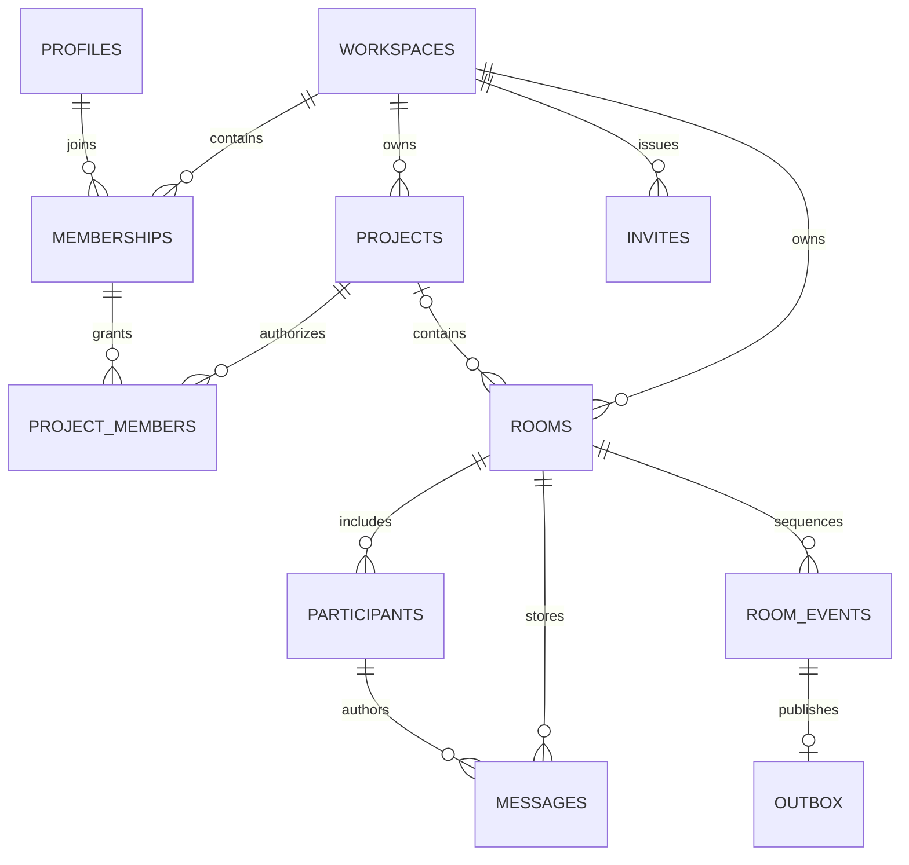
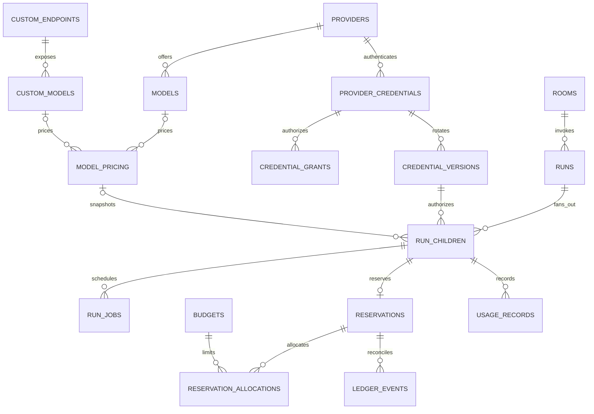
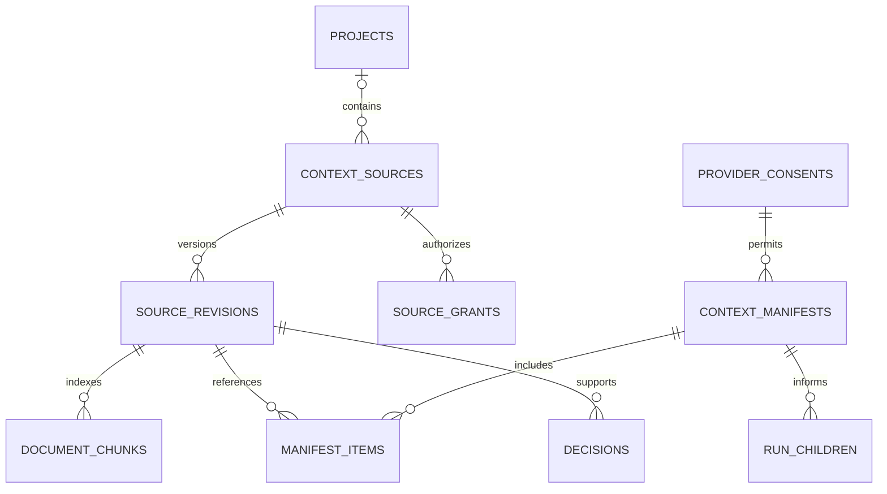
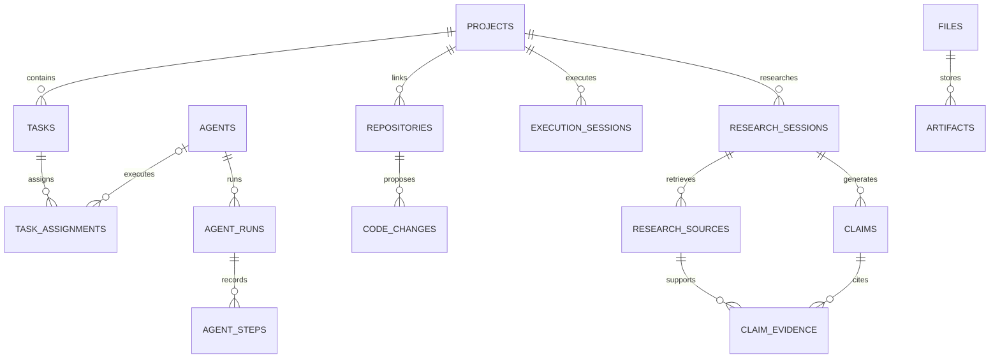

# AISwitch — Database Design and ERD
Version 1.0 | 2026-11-25 | Proposed logical schema

## 1. Scope
Derived from PRD/SRS v1.2, SAD v1.0, HAC and CTX. PostgreSQL authoritative; Redis transient; private object storage for binaries. This is a logical schema and migration blueprint, not executable DDL or deployed database.

## 2. Conventions
UUID primary keys unless composite specified; shorthand id means UUID PK, workspace_id means required tenant FK, timestamps UTC timestamptz. Every tenant-owned parent has unique(workspace_id,id); every tenant-owned child uses composite FK to its parent, including join tables. Fields ending _id are intended FKs unless explicitly external or polymorphic; polymorphic scope/target validated by typed service and database constraints in physical design. Default NOT NULL except explicitly optional or lifecycle-dependent. Monetary amounts numeric(24,8), ISO currency; never float. All status values constrained. Global provider/model catalog read-only to clients; custom endpoints/models tenant-owned. Secret schema inaccessible to browser roles.

## 3. Table catalog (57 logical entities)
### Identity and collaboration (P0)
| Table | Proposed fields | Constraints and purpose |
|---|---|---|
| profiles | id uuid PK/FK auth.users, display_name text, created_at timestamptz | identity only; no provider secrets |
| workspaces | id uuid PK, name text, owner_id uuid FK profiles, kind text, created_at | personal or team |
| memberships | workspace_id, user_id, role, status, joined_at | PK(workspace_id,user_id); active owner/editor/viewer |
| projects | id, workspace_id, name, instructions, revision bigint, archived_at | unique(workspace_id,id) |
| project_members | workspace_id, project_id, user_id, role | composite FK project and membership; explicit access |
| invites | id, workspace_id, project_id nullable, email_hash, token_hash, role, expires_at, accepted_at | unique token_hash; single use |
| rooms | id, workspace_id, project_id nullable, owner_id, visibility, next_seq bigint | private/shared; project required for shared |
| participants | id, workspace_id, room_id, kind, user_id nullable, model_id nullable, label | human or AI; validate discriminator |
| messages | id, workspace_id, room_id, participant_id, client_id, body, status, created_at | unique(room_id,participant_id,client_id); participant belongs to room |
| room_events | workspace_id, room_id, seq bigint, event_id uuid, kind, payload jsonb, created_at | PK(room_id,seq); unique event_id |
| outbox | id, workspace_id, event_id, topic, payload, available_at, published_at, attempts | unique event_id; no secrets |
| activity_events | id, workspace_id, project_id, actor_id, kind, target_id, created_at | append-only redacted metadata |

### Gateway and execution (P0)
| Table | Proposed fields | Constraints and purpose |
|---|---|---|
| providers | id, slug, adapter_type, enabled | global catalog; unique slug |
| provider_credentials | id, workspace_id, owner_id, provider_id, alias, visibility, status | metadata only; private by default |
| credential_versions | id, workspace_id, credential_id, version, ciphertext bytea, wrapped_key bytea, nonce bytea, kms_ref, revoked_at | restricted schema; unique credential/version |
| credential_grants | workspace_id, credential_id, user_id, project_id nullable, expires_at | explicit scoped grant; unique scope |
| models | id, provider_id, external_id, capabilities jsonb, context_limit, output_limit, enabled | unique provider/external ID; custom models scoped via endpoint |
| custom_endpoints | id, workspace_id, owner_id, provider_id, base_url, protocol, enabled | validated destination; secret headers in vault |
| custom_models | id, workspace_id, endpoint_id, external_id, capabilities, context_limit, output_limit | unique endpoint/external ID |
| model_pricing | id, model_id nullable, custom_model_id nullable, workspace_id nullable, currency, input_rate numeric, output_rate numeric, effective_at | exactly one model; immutable version; unknown price explicit |
| runs | id, workspace_id, room_id, initiator_id, mode, status, idempotency_key, created_at | unique workspace/initiator/idempotency_key |
| run_children | id, workspace_id, run_id, participant_id, credential_version_id, model_id nullable, custom_model_id nullable, pricing_id, manifest_id, status, attempt, cancel_requested_at | exactly one model; independent state |
| run_jobs | id, workspace_id, child_id, state, lease_until, attempt, available_at | durable queue recovery; unique child/attempt |
| provider_consents | id, workspace_id, project_id nullable, user_id, provider_id, scope, revision, revoked_at | explicit destination/scope authorization |

### Shared intelligence (P0/P1)
| Table | Proposed fields | Constraints and purpose |
|---|---|---|
| context_sources | id, workspace_id, project_id nullable, owner_id, visibility, kind, state | private/shared; explicit source ownership |
| source_revisions | id, workspace_id, source_id, revision, content_ref, content_hash, author_id, created_at | unique source/revision; immutable |
| source_grants | workspace_id, source_id, user_id, permission | explicit ACL |
| context_manifests | id, workspace_id, initiator_id, provider_id, consent_id, token_estimate, created_at | immutable dispatch provenance |
| manifest_items | workspace_id, manifest_id, revision_id, ordinal, token_estimate | PK(manifest_id,ordinal); no duplicated raw content |
| document_chunks | id, workspace_id, revision_id, ordinal, text, embedding_ref, indexed_at | P1; unique revision/ordinal; derived |
| decisions | id, workspace_id, project_id, revision_id, status, approved_by, approved_at | P1; AI proposal not approved automatically |

### Budgets and usage (P0)
| Table | Proposed fields | Constraints and purpose |
|---|---|---|
| budgets | id, workspace_id, scope_kind, scope_id, period_start, period_end, currency, limit_amount numeric, reserved_amount numeric, spent_amount numeric | nonnegative; unique scope/period/currency; scope validated |
| reservations | id, workspace_id, child_id, currency, amount numeric, status, created_at | unique child; conservative estimate |
| reservation_allocations | workspace_id, reservation_id, budget_id, amount numeric | PK(reservation_id,budget_id); same currency |
| usage_records | id, workspace_id, child_id, provider_request_id, input_tokens, output_tokens, cost numeric nullable, currency, quality, recorded_at | append-only; dedup event key required |
| ledger_events | id, workspace_id, reservation_id, budget_id, event_key, kind, amount numeric, created_at | unique event_key; immutable reconciliation history |

### Engineering and research (P1/P2)
| Table | Proposed fields | Constraints and purpose |
|---|---|---|
| files | id, workspace_id, project_id, owner_id, object_key, mime, size_bytes, hash, status | private storage; validated upload |
| artifacts | id, workspace_id, project_id, file_id, version, kind | versioned outputs |
| repositories | id, workspace_id, project_id, integration_id, remote_ref, base_sha | scoped Git connection |
| code_changes | id, workspace_id, repository_id, base_sha, patch_file_id, status | reviewed patch |
| execution_sessions | id, workspace_id, project_id, state, expires_at, runtime_ref | isolated runtime |
| tasks | id, workspace_id, project_id, title, state, owner_id, revision | accountable human |
| task_assignments | id, workspace_id, task_id, user_id nullable, agent_id nullable | exactly one assignee |
| agents | id, workspace_id, project_id, name, model_ref, policy jsonb | scoped capabilities |
| agent_runs | id, workspace_id, agent_id, task_id, status, step_limit | durable execution |
| agent_steps | id, workspace_id, agent_run_id, ordinal, status, result_ref | unique run/ordinal |
| approvals | id, workspace_id, actor_id, action_hash, target_ref, expires_at, consumed_at | single-use revision-bound |
| research_sessions | id, workspace_id, project_id, status, plan jsonb | bounded research |
| research_sources | id, workspace_id, session_id, url, retrieved_at, content_hash, file_id | evidence provenance |
| claims | id, workspace_id, session_id, text, verification_status | unsupported/conflicting explicit |
| claim_evidence | workspace_id, claim_id, source_id, excerpt, locator | many-to-many evidence |
| integrations | id, workspace_id, owner_id, provider, secret_ref, scopes, status | secret_ref restricted vault |
| deployments | id, workspace_id, project_id, revision, target, approval_id, status | P2 production approval |
| workflows | id, workspace_id, project_id, definition jsonb, version | P2 |
| workflow_runs | id, workspace_id, workflow_id, trigger_key, status | P2 unique workflow/trigger |
| prompt_templates | id, workspace_id, owner_id, visibility, body, version | P0 save; P1 variables |
| audit_logs | id, workspace_id, actor_id, action, target_ref, trace_id, created_at | append-only redacted |

## 4. ERD — identity and collaboration

## 5. ERD — AI gateway and budget

## 6. ERD — shared intelligence

## 7. ERD — engineering and research

## 8. Authorization and RLS design
Enable RLS on all exposed tenant tables; deny by default. Authenticated identity from verified JWT; never trust supplied workspace ID. Active membership plus project/room ACL required; private rooms and sources owner-only unless explicitly granted. Viewer read only; editor contributes; owner manages invites and spending. No direct client writes to ledger, outbox, audit, credential versions or run state. Secret resolver role alone reads encrypted material; no browser grant. Backend service role bypass risk requires explicit policy checks and narrow DB roles. Revoke memberships and subscriptions; check again before dispatch. RLS policy pseudocode: SELECT allowed if active_member(workspace_id) AND can_read_resource(auth.uid(), resource_id); INSERT/UPDATE require corresponding write policy and WITH CHECK. Implement helpers with fixed search_path, minimal grants and recursion tests. No actual policies deployed.

## 9. Transactional collaboration
Begin; authorize membership; lock room row; deduplicate client message; allocate next sequence; insert message, room event and outbox in same transaction; commit then acknowledge. Relay at-least-once; client dedup by event_id/seq. On reconnect query room_events after cursor or return authorized snapshot. Revocation invalidates active subscription. Private runs never emit shared events. Persist AI partial checkpoints and terminal messages.

## 10. Financial invariants
Reserve all applicable budget scopes in one transaction, locking rows in deterministic ID order; require spent + reserved + requested <= limit for each. Insert reservation, allocations and ledger events atomically. Settlement locks same scopes, deduplicates provider usage event, releases reserved amount and adds actual cost. Actual overrun recorded and future dispatch blocked; never discard provider-reported cost. Unknown usage remains reconciliation_required. Do not sum allocation rows across scopes as actual spend: usage record is canonical cost. Currency conversion not implicit. Shared key payer policy checked before reserve and dispatch. Pricing version immutable.

## 11. Context and lifecycle
Source revisions immutable; approval and supersession explicit. Manifest references exact revisions, consent and token estimate. Deletion/revocation blocks retrieval immediately and queues derived chunk/cache invalidation. Historical manifests may retain redacted identifiers subject to retention; do not preserve deleted raw content indefinitely. P1 vector index dimension/model chosen by ADR; filter tenant/ACL before ranking. File objects use private bucket and scoped short-lived access.

## 12. Index plan
Membership(user_id,workspace_id,status); project_members(project_id,user_id); rooms(workspace_id,project_id); messages(room_id,created_at,id); room_events(room_id,seq); outbox(available_at) WHERE published_at IS NULL; run_children(run_id,status); run_jobs(state,available_at,lease_until); credentials(workspace_id,owner_id,provider_id); source_revisions(source_id,revision DESC); chunks(workspace_id,revision_id); usage_records(workspace_id,recorded_at); budgets(workspace_id,scope_kind,scope_id,period_start); audit_logs(workspace_id,created_at). Add composite FK indexes; validate query plans before production. Full-text search P0 candidate; vector index P1.

## 13. Migration plan
001 identity/workspaces; 002 projects/rooms/events; 003 gateway catalog/vault; 004 context/consents; 005 runs/jobs; 006 budgets/ledger; 007 prompts/activity/audit; 008 RLS and grants (apply each table's deny-default policies before exposure, not only at end); P1 files/index/engineering/research; P2 workflows/deployments. Use transactional migrations where supported, staged backfills, expand-contract changes, seed nonsecret provider catalog, separate dev/staging/prod. Test fresh install and upgrade; no destructive rollback without backup.

## 14. Verification and recovery
Planned tests: DB-01 cross-tenant FK rejection; DB-02 RLS outsider denial; DB-03 private credential/source exclusion; DB-04 invite replay; DB-05 concurrent message sequence/dedup; DB-06 outbox crash/replay; DB-07 concurrent budget race; DB-08 settlement idempotency/unknown charge; DB-09 context revocation/deletion; DB-10 secret schema denial; DB-11 migration fresh/upgrade; DB-12 restore DB and objects; DB-13 stale patch; DB-14 approval replay. Daily backup, RPO 24h/RTO 4h proposed; verify restore drills and retention.

## 15. Open decisions
Physical DDL, complete field types/nullability/check constraints, custom model reference strategy, polymorphic scope integrity, usage dedup key, retention, KMS, exact RLS functions, vector dimensions and migration tooling require implementation review. No SQL executed, Supabase project provisioned or database tests run. ERDs are logical subsets, not exhaustive physical diagrams.
