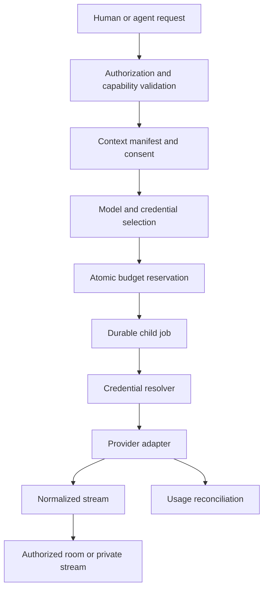

# AISwitch — Universal AI Gateway
Version 1.0 | 2026-11-25 | Proposed specification

## 1. Scope
Provider-independent execution boundary for PRD/SRS v1.2, SAD, database, MMC, HAC and CTX. P0 manual routing, BYOK, parallel and basic shared group chat; P1 automatic routing, advanced debate and local bridge; P2 agent task graphs. No provider integration implemented yet.

## 2. Architecture

Gateway owns provider adapters and execution; collaboration owns room ACL; context owns retrieval; budget owns ledger; orchestration owns task sequencing. No direct cross-module writes. Trusted worker resolves secrets immediately before dispatch.

## 3. Provider rollout
| Provider | Priority | Adapter strategy |
|---|---|---|
| OpenAI | P0 | Native |
| Anthropic | P0 | Native |
| OpenRouter | P0 | Compatible with explicit upstream routing policy |
| Custom HTTPS endpoints | P0 | OpenAI-compatible subset |
| Gemini | P1 | Native |
| DeepSeek | P1 | Compatible where verified |
| Groq | P1 | Compatible where verified |
| xAI | P1 | Compatible where verified |
| Mistral | P1 | Native or compatible after evaluation |
| Ollama | P1 | Local bridge |
| LM Studio | P1 | Local bridge |
| Azure OpenAI | P2 | Deployment-aware adapter |
| AWS Bedrock | P2 | Native signed requests |
| Hugging Face | P2 | Endpoint-specific adapter |
These are planned targets, not verified current capabilities. Provider contracts, credit eligibility, model availability and pricing must be checked against official documentation during implementation.

## 4. Adapter contract
Illustrative Python protocol; implementation and types pending:
```python
class ProviderAdapter(Protocol):
    async def validate_credential(self, credential, endpoint): ...
    async def list_models(self, credential, endpoint): ...
    async def capabilities(self, model_ref): ...
    def stream(self, request, credential) -> AsyncIterator[GatewayEvent]: ...
    async def cancel(self, upstream_request_id): ...
    def normalize_usage(self, raw_usage): ...
    def normalize_error(self, error): ...
```
Credential handle is opaque outside resolver; adapters receive short-lived resolved secret in trusted process only. Cancellation is best effort. Discovery may be unsupported; allow manual registration. Unsupported capabilities fail explicitly rather than silently dropping parameters.

## 5. Normalized request
request_id, idempotency_key, workspace_id, room_id, initiator_id, participant_id, model_ref, credential_ref, context_manifest_id, messages, attachments, tools, response_format, max_output_tokens, temperature (optional), deadline, policy_version, trace_id. Model reference distinguishes provider catalog and tenant custom endpoint. Validate input size, role mapping, tool schemas, media type and model limits. Do not silently truncate user content; disclose context reduction. Provider-specific options namespaced and allowlisted.

## 6. Stream contract
Events: accepted, queued, started, text_delta, reasoning_summary (only if provider exposes permitted summary), tool_call_delta, tool_call_ready, usage_update, warning, completed, failed, cancelled. Envelope: schema_version, event_id, parent_run_id, child_run_id, sequence, timestamp, type, payload. Terminal event exactly once in durable state; transport at-least-once with dedup. Never expose hidden reasoning or raw provider error secrets. Buffer tool arguments until validated; execution is separate authorized action. SSE private stream; room WebSocket authorized shared updates. Persist checkpoints; reconnect from cursor or snapshot.

## 7. Credential management
Multiple credentials per provider; aliases, masked metadata, owner, scope, status, endpoint binding, rotation history. Personal default; shared grant explicit per member/project and budget. Envelope encryption with KMS candidate; separate restricted schema. Never send secret to browser, agent, logs, context or sandbox. Validate via least-cost supported call with disclosure if billable. Rotate by creating version; revoke old version and block new dispatch; in-flight calls may still complete. Do not silently switch payer or credential. Expired grants deny. Custom endpoint key never reused at another origin.

## 8. Model registry
Catalog fields: provider, external ID, display label, modality, context/output limits, streaming, tools, structured output, vision/audio, embedding, pricing version, source, verified_at, status. Capability values supported/unsupported/unknown. Discovery per authorized credential where applicable; cache tenant-specific availability separately from global metadata. Manual custom model entry requires endpoint and capability declaration. Unknown pricing or capabilities visible; do not assume free. Deprecated models disabled for new runs while preserving history.

## 9. Routing
P0 explicit provider/model/key selection. P1 policy filters eligible candidates by consent, credential grant, capability, context size, region/data policy, budget and health; ranks by configurable quality, estimated cost and latency. Modes manual, economy, performance, fast, research, coding, comparison, collaborative and custom. Quality estimates require benchmarks; no universal best model. Return selected model and rationale. Fallback opt-in with allowed model/provider/payer list, fresh consent and reservation; never silently send private data to another provider. No automatic retry after ambiguous billable dispatch.

## 10. Collaboration modes
Single, parallel comparison, basic group conversation P0; bounded debate, moderator and dynamic participants P1; task graph P2. Parent run fans out independent children; each has own model, credential version, context manifest, reservation and cancellation. Parallel uses same authorized prompt snapshot where compatible; group uses ordered shared history and explicit mentions. Human-only messages do not trigger AI by default. Each child output labeled with model and actor. Advanced rounds bounded by count, tokens, time and money. Synthesis is an additional billable child. Preserve disagreements and partial failures.

## 11. Execution lifecycle
See [execution and financial state machines](25-state-machines.md) for the normative proposed transition contract. Execution terminal states are completed, failed and cancelled; reconciliation_required belongs only to financial accounting. Worker leases, fencing, dispatch intent and evidence-based retries follow that contract. Parent aggregates independent children; late usage does not change terminal execution.

## 12. Context and privacy
Assemble exact source revisions per child; ACL before retrieval and dispatch, provider consent per destination. Include project instructions, authorized messages and curated facts P0; semantic retrieval P1. Context manifest records provenance, token estimate, provider, policy and consent. Treat retrieved text as untrusted data. Private content excluded by default. Provider-specific role mapping preserves instruction hierarchy. Cache only within authorized tenant/scope/revision/model/policy; provider caching opt-in. No claim of provider retention guarantees without verification.

## 13. Cost, credits and budgets
Estimate input/output/tool/media/cache charges using immutable pricing version and provider-specific units. Reserve conservative bound across applicable scopes atomically; unknown price blocks capped paid execution unless explicit bounded policy approved. Reconcile provider-reported usage; mark estimated or unknown, never invent exact costs. Track payer alias, initiator, model, request ID, currency, timestamp. Credits: manual balance/expiry and verified provider balance if supported; distinguish local estimate from actual provider invoice. No pooling or transferring credits across accounts/providers. Credits may restrict eligible models or expire; validate terms. Budget overrun from actual charges recorded and future calls blocked. No guarantee of external hard cap. Example hypothetical: 10k input at $2/M plus 2k output at $8/M = $0.036, excluding other charges.

## 14. Resource optimization
Token budgeting, relevant context selection, bounded summaries, duplicate task detection, concurrency limits, cancellation, output caps, model-specific caching and cheaper eligible routing P1. Measure cost per accepted task, latency, quality, cache hits and context repetition. Do not trade quality or privacy for savings without policy. Fair scheduling per workspace/provider; bounded queues and backpressure.

## 15. Error taxonomy
AUTH_INVALID, ACCESS_DENIED, CONSENT_REQUIRED, MODEL_UNAVAILABLE, CAPABILITY_UNSUPPORTED, CONTEXT_TOO_LARGE, BUDGET_EXCEEDED, PRICE_UNKNOWN, RATE_LIMITED, PROVIDER_TIMEOUT, PROVIDER_UNAVAILABLE, INVALID_REQUEST, CONTENT_RESTRICTED, STREAM_INTERRUPTED, CANCELLED, USAGE_UNKNOWN, ENDPOINT_BLOCKED. Include safe message, retryability, trace ID and optional retry-after. Never leak provider raw headers or secrets. Independent child errors do not stop siblings. Circuit breaker scoped to endpoint/credential where appropriate.

## 16. Custom and local endpoints
HTTPS custom endpoints only P0; validate DNS and every redirect, block private/link-local/metadata addresses, enforce egress proxy, timeouts and response limits. No arbitrary headers from untrusted input. P1 local bridge initiates authenticated outbound connection, explicit user pairing, scoped model access, no public localhost proxy; local model data stays local unless user authorizes sharing. Local compute costs not assumed zero. Test endpoint ownership and secret binding.

## 17. Observability
Trace parent/child/job IDs; metrics queue delay, first token latency, completion latency, errors, cancellation, token usage, reservation drift, unknown usage, provider availability. Redact prompts and secrets by default; tenant-scoped usage reports. Alerts on anomalous spend and reconciliation backlog. Benchmark before setting production limits.

## 18. Requirements and acceptance
| ID | Priority | Requirement / planned test |
|---|---|---|
| GW-001 | P0 | Register two keys for same provider; select each independently |
| GW-002 | P0 | Mask credentials; browser and logs never receive secret |
| GW-003 | P0 | Rotate/revoke key; new dispatch denied for revoked version |
| GW-004 | P0 | Discover models or manually register when unsupported |
| GW-005 | P0 | Reject unsupported modality/tool capability |
| GW-006 | P0 | Normalize native OpenAI and Anthropic mock streams |
| GW-007 | P0 | Compatible adapter handles OpenRouter/custom mock |
| GW-008 | P0 | Two child streams progress concurrently |
| GW-009 | P0 | Cancel one child without cancelling sibling |
| GW-010 | P0 | Reconnect without duplicate durable messages |
| GW-011 | P0 | Shared group mention targets authorized AI only |
| GW-012 | P0 | Human-only message creates no paid call |
| GW-013 | P0 | Private context excluded from shared dispatch |
| GW-014 | P0 | Revoked membership/consent blocks queued dispatch |
| GW-015 | P0 | Concurrent reservations respect local budget |
| GW-016 | P0 | Usage settlement idempotent; unknown usage retained |
| GW-017 | P0 | Unknown price handled explicitly |
| GW-018 | P0 | Shared key requires scoped grant and payer policy |
| GW-019 | P0 | Custom endpoint SSRF and redirect tests |
| GW-020 | P0 | Ambiguous timeout does not blindly retry |
| GW-021 | P0 | Provider error redacted and normalized |
| GW-022 | P0 | Manual credit balance labeled estimate |
| GW-023 | P1 | Automatic routing respects capability and budget |
| GW-024 | P1 | Fallback requires explicit allowed destination/payer |
| GW-025 | P1 | Debate stops at configured round/cost cap |
| GW-026 | P1 | Local bridge pairing and revocation |
| GW-027 | P1 | Context cache cannot cross tenant boundaries |
| GW-028 | P2 | Agent tool calls require scoped approval |
All tests planned; use mocked adapters first, then opt-in live smoke tests with explicit small budgets.

## 19. Implementation sequence
Adapter types and fixtures → credential resolver → provider registry → native adapters → compatible adapter → durable execution and streams → budget integration → group/parallel orchestration → security and contract tests → opt-in live validation. P1 routing/local bridge later. Do not require paid calls in default CI.

## 20. Open decisions
Native SDK versions, optional LiteLLM evaluation, pricing refresh source, token estimation accuracy, provider-specific idempotency, KMS, local bridge protocol and queue implementation pending ADRs. Database follow-up: participant custom model reference, pricing units, endpoint-specific credential binding, usage event dedup, credit balance/expiry records and separate reconciliation state. API/OpenAPI next. No provider APIs called, credits consumed or credentials configured in this milestone.
